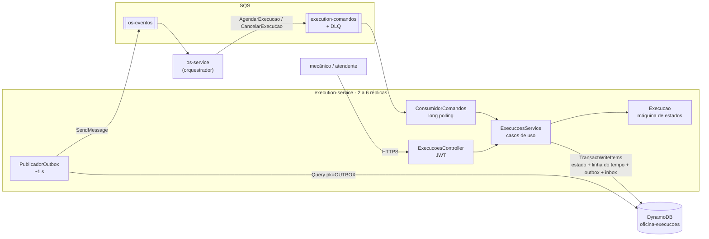
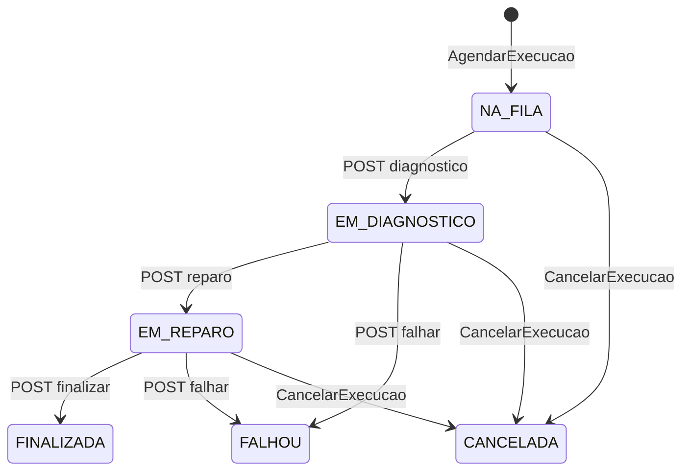
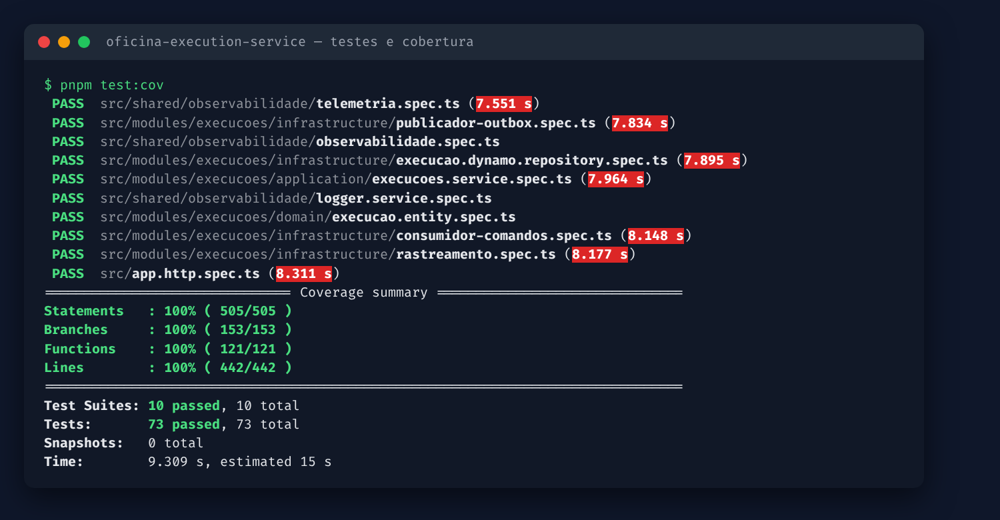
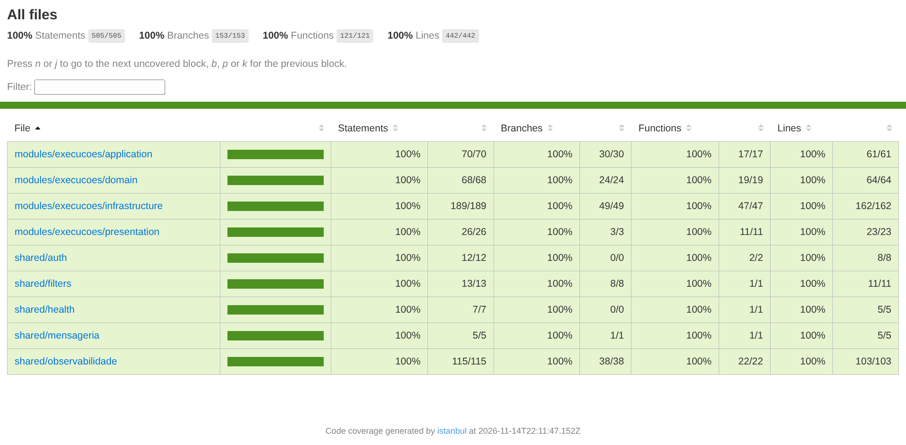

# oficina-execution-service

Microsserviço de **execução da ordem de serviço** do Tech Challenge SOAT, Fase 4: fila da oficina, diagnóstico, reparo e linha do tempo de cada execução.

Faz parte da saga orquestrada pelo `oficina-os-service`: recebe comandos em `execution-comandos` e publica eventos em `os-eventos`, seguindo o contrato de mensagens da fase (`CONTRATO-MENSAGENS.md`). Não lê o banco de nenhum outro serviço.

## Tecnologias

- **NestJS 11** + **TypeScript**, Clean Architecture (domain / application / infrastructure / presentation)
- **Amazon DynamoDB** (tabela única) com `@aws-sdk/client-dynamodb` + `@aws-sdk/lib-dynamodb`
- **Amazon SQS** com `@aws-sdk/client-sqs` (long polling, DLQ)
- **JWT HS256** (Passport) · **Swagger** em `/docs` · **prom-client** em `/api/metrics` · log JSON com `correlationId` · **OpenTelemetry** (traces e logs OTLP)
- **Jest** + `aws-sdk-client-mock` + supertest
- **Docker** · **Kubernetes** (EKS) · **Terraform** · **GitHub Actions** (gitleaks, CodeQL)

## Arquitetura



### Máquina de estados (domínio, sem framework)



Transição inválida → `400`; execução inexistente → `404`; escrita concorrente na mesma execução → `409`.

### Estrutura

```
src/
├── main.ts · app.module.ts
├── modules/execucoes/
│   ├── domain/          Execucao (máquina de estados, linha do tempo), StatusExecucao, port do repositório
│   ├── application/     ExecucoesService (agendar, cancelar, diagnóstico, reparo, finalizar, falhar, fila)
│   ├── infrastructure/  ExecucaoDynamoRepository, ConsumidorComandos (SQS), PublicadorOutbox
│   └── presentation/    ExecucoesController + DTOs
└── shared/              auth (JWT), filters, health, mensageria (envelope), observabilidade
```

## Por que NoSQL (DynamoDB)

- **Agregado por OS, sem joins.** A execução e a sua linha do tempo são sempre lidas e escritas juntas, pela OS. Na tabela única elas compartilham a mesma partição (`EXEC#{osId}`), e uma `Query` traz tudo de uma vez.
- **A fila é um índice.** "Quem está na fila, em ordem de chegada" é um `Query` no GSI por status, já ordenado pela chave de ordenação. Não precisa de `ORDER BY` nem de varrer a tabela.
- **Escrita alta e só por acréscimo.** Cada etapa grava um item novo na linha do tempo. O DynamoDB escala a escrita na horizontal (on-demand, `PAY_PER_REQUEST`) sem pool de conexões. Isso combina com o HPA, que sobe até 6 pods.
- **Transações onde importa.** `TransactWriteItems` garante a atomicidade entre estado, outbox e inbox, que é o mesmo papel que a transação do Postgres cumpre nos outros serviços.

## Modelagem DynamoDB (tabela única `oficina-execucoes`)

Todas as datas são **epoch em milissegundos** (`number`, atributo `N`). Nas chaves de ordenação string, o número leva zeros à esquerda até 13 dígitos (`ms13`) para ordenar corretamente como texto.

| Item | `pk` | `sk` | `gsi1pk` | `gsi1sk` | Atributos |
|---|---|---|---|---|---|
| Execução | `EXEC#{osId}` | `META` | `STATUS#{status}` | `{enfileiradaEm ms13}#{osId}` | `execucaoId, osId, osNumero, veiculo, itens, status, enfileiradaEm, atualizadaEm, finalizadaEm?, motivo?, versao` |
| Linha do tempo | `EXEC#{osId}` | `EVT#{em ms13}#{uuid}` | — | — | `etapa, observacao?, em` |
| Inbox | `MSG#{messageId}` | `MSG` | — | — | `processadaEm, ttl` (expira em 7 dias) |
| Outbox | `OUTBOX` | `{criadoEm ms13}#{uuid}` | — | — | `tipo, fila, corpo (envelope JSON), correlationId, criadoEm` |

### Padrões de acesso

| Acesso | Operação |
|---|---|
| Execução + linha do tempo de uma OS | `Query pk = EXEC#{osId}` (leitura consistente) → `META` + `EVT#…` já em ordem cronológica |
| Fila por status em ordem de chegada | `Query gsi1 gsi1pk = STATUS#{status}` (ordenada por `gsi1sk`) |
| Fila ativa (`GET /fila`) | 3 queries no `gsi1` (NA_FILA, EM_DIAGNOSTICO, EM_REPARO); o domínio ordena: em andamento primeiro, depois chegada |
| Posição na fila | `Query gsi1 gsi1pk = STATUS#NA_FILA AND gsi1sk < {minha chave}` com `Select COUNT`, + 1 |
| Tamanho da fila por status (métrica) | `Select COUNT` no `gsi1`, feito na hora do scrape |
| Mensagens pendentes do outbox | `Query pk = OUTBOX` (ordem de criação, lotes de 25) |
| Mudança de estado | `TransactWriteItems`: `[inbox?] + META (Put condicional) + EVT novos + OUTBOX` |

**Concorrência otimista:** `META` é gravado com `ConditionExpression`. Na criação usa `attribute_not_exists(pk)`. Na alteração usa `versao = :versaoLida` e grava `versao + 1`. Se outra operação gravou antes, a transação é cancelada: na API isso vira `409`, e no consumidor a mensagem volta para a fila e é reprocessada.

## Garantias de mensageria (outbox e inbox no DynamoDB)

- **Outbox transacional:** o evento é um item `pk = OUTBOX` gravado na **mesma** `TransactWriteItems` da mudança de estado. Se o processo cair depois do commit, nada se perde. O `PublicadorOutbox` roda a cada ~1 s (`OUTBOX_INTERVAL_MS`, desligável com `OUTBOX_PUBLISHER_ENABLED=false`): ele lê `pk = OUTBOX`, faz o `SendMessage` e **só depois** apaga o item. Se o processo cair entre o envio e o delete, ou se duas réplicas publicarem o mesmo item, sai uma duplicata, que o consumidor idempotente do os-service descarta pelo `messageId`.
- **Inbox idempotente:** cada comando processado grava `pk = MSG#{messageId}` com `attribute_not_exists(pk)` na mesma transação do efeito. O item de inbox fica sempre na posição 0 da transação. Se a transação for cancelada por essa condição, a mensagem é duplicada: o serviço registra o aviso e apaga a mensagem da fila.
- **Consumidor:** long polling (`WaitTimeSeconds 20`, até 10 mensagens). Começa no bootstrap e para no shutdown (aborta o polling em curso). Pode ser desligado com `SQS_CONSUMER_ENABLED=false`. Apaga a mensagem só depois do sucesso. Em erro, a mensagem volta após o visibility timeout e, depois de 5 tentativas, vai para a `execution-comandos-dlq`. Corpo inválido, tipo desconhecido ou `messageId` ausente também seguem esse caminho até a DLQ.

## Mensagens

Envelope igual ao do contrato: `{ messageId, type, correlationId (= osId), occurredAt (epoch ms), source: "execution-service", payload, traceparent? }`. O campo `traceparent` (W3C) é opcional e serve ao rastreamento distribuído. Também são enviados como *message attributes* `type` e `correlationId`.

**Consumidas (`execution-comandos`)**

| type | Efeito |
|---|---|
| `AgendarExecucao` `{ osId, osNumero, veiculo, itens }` | Cria a execução em `NA_FILA` e publica `ExecucaoAgendada`. Idempotente por `osId`: se a execução já existe, só republica `ExecucaoAgendada` (com `posicaoNaFila = 0` se ela já saiu da fila). |
| `CancelarExecucao` `{ osId, motivo }` | Se a execução não está FINALIZADA/FALHOU: muda para `CANCELADA` e publica `ExecucaoCancelada`. Se já está cancelada, republica o evento. Se está FINALIZADA/FALHOU ou não existe, ignora (com log) e apaga a mensagem. |

**Publicadas (`os-eventos`)**

| type | payload | Quando |
|---|---|---|
| `ExecucaoAgendada` | `{ osId, execucaoId, posicaoNaFila }` | AgendarExecucao |
| `ExecucaoAtualizada` | `{ osId, execucaoId, etapa, observacao? }` | diagnóstico (`EM_DIAGNOSTICO`) e reparo (`EM_REPARO`) |
| `ExecucaoFinalizada` | `{ osId, execucaoId }` | finalizar |
| `ExecucaoFalhou` | `{ osId, execucaoId, motivo }` | falhar: dispara a compensação (estorno + liberação de estoque) |
| `ExecucaoCancelada` | `{ osId, execucaoId }` | CancelarExecucao |

## Rotas

Prefixo `/api`. Swagger em `/docs`. Rotas de execução exigem `Authorization: Bearer <JWT HS256>` assinado com `JWT_SECRET` (o mesmo segredo da Lambda de auth). Datas nas respostas em epoch ms.

| Método | Rota | Descrição |
|---|---|---|
| GET | `/api/health` | Liveness/readiness (público) |
| GET | `/api/metrics` | Prometheus (público na rede do cluster) |
| GET | `/api/execucoes/fila` | NA_FILA, EM_DIAGNOSTICO e EM_REPARO; em andamento primeiro, depois por chegada |
| GET | `/api/execucoes/:osId` | Execução + `linhaDoTempo` |
| POST | `/api/execucoes/:osId/diagnostico` | `{ observacao? }` NA_FILA → EM_DIAGNOSTICO |
| POST | `/api/execucoes/:osId/reparo` | `{ observacao? }` EM_DIAGNOSTICO → EM_REPARO |
| POST | `/api/execucoes/:osId/finalizar` | EM_REPARO → FINALIZADA |
| POST | `/api/execucoes/:osId/falhar` | `{ motivo }` EM_DIAGNOSTICO/EM_REPARO → FALHOU |

Collection Postman: `postman/oficina-execution-service.postman_collection.json` (variáveis `{{baseUrl}}`, `{{token}}`, `{{osId}}`).

## Observabilidade

Log JSON (`LOG_FORMAT=json`) com `servico`, `contexto` e `correlationId`. Na HTTP, ele vem de `x-correlation-id`. No consumo e na publicação, é o `correlationId` da mensagem, ou seja, o id da OS.

| Métrica | Tipo | Rótulos |
|---|---|---|
| `oficina_execucao_fila_tamanho` | gauge (lido do DynamoDB no scrape, consistente entre réplicas) | `status` |
| `oficina_execucao_duracao_segundos` | histogram (NA_FILA → FINALIZADA) | — |
| `oficina_execucao_transicoes_total` | counter | `etapa` |
| `oficina_execucao_falhas_total` | counter | — |
| `oficina_mensagens_consumidas_total` | counter | `tipo`, `resultado` (sucesso/duplicada/erro) |
| `oficina_mensagens_publicadas_total` | counter | `tipo` |
| `http_requests_total`, `http_request_duration_seconds` | counter / histogram | `method`, `route`, `status` |

### Rastreamento distribuído (OpenTelemetry)

`src/tracing.ts` é o primeiro import do `main.ts` e liga o `NodeSDK` **só quando `OTEL_EXPORTER_OTLP_ENDPOINT` existe**. Testes e CI rodam sem ele. As auto-instrumentações cobrem HTTP, Express e aws-sdk (DynamoDB e SQS). Traces e logs saem por OTLP/HTTP com `OTEL_SERVICE_NAME=execution-service` (padrão). `OTEL_METRICS_EXPORTER=none`, porque as métricas continuam no prom-client.

- **Propagação pela mensagem:** o envelope ganhou o campo opcional `traceparent` (W3C), preenchido em `criarEnvelope` com o contexto ativo.
- **O trace sobrevive ao outbox:** o envelope é criado dentro do span de `processar AgendarExecucao`/`CancelarExecucao` ou dentro da requisição HTTP (diagnóstico, reparo, finalizar, falhar). Por isso o item `OUTBOX` no DynamoDB já guarda o `traceparent` de origem. O publicador, mesmo rodando depois e em outra réplica, abre o span `publicar <tipo>` (PRODUCER) como filho desse contexto.
- **Consumo:** cada comando roda em `processar <tipo>` (CONSUMER), filho do `traceparent` que veio no envelope do os-service. O resultado é um único trace por OS, de serviço em serviço.
- **Logs:** o `LoggerService` também emite cada linha como log OTel (severidade e atributos `contexto`, `correlationId`, `detalhe`), com `trace_id`/`span_id` do span ativo. Esses logs vão para o Loki.

## Como rodar localmente

Pré-requisito: a infra compartilhada da fase em `../local` rodando (Floci em `localhost:4566` com as filas e a tabela). Se as filas ou a tabela sumirem, rode `docker compose -f ../local/docker-compose.yml run --rm aws-init`.

```bash
cp .env.example .env          # valores locais, nenhum segredo real
pnpm install
pnpm start:dev                # http://localhost:3003/api  ·  Swagger em /docs
```

Ou via container, na rede `oficina-local_default`:

```bash
docker compose up --build
```

Exemplo de ponta a ponta:

```bash
export AWS_ACCESS_KEY_ID=test AWS_SECRET_ACCESS_KEY=test AWS_DEFAULT_REGION=us-east-1
aws --endpoint-url=http://localhost:4566 sqs send-message \
  --queue-url http://localhost:4566/000000000000/execution-comandos \
  --message-attributes '{"type":{"DataType":"String","StringValue":"AgendarExecucao"},"correlationId":{"DataType":"String","StringValue":"os-123"}}' \
  --message-body '{"messageId":"8b1f8d2e-0000-4000-8000-000000000001","type":"AgendarExecucao","correlationId":"os-123","occurredAt":1763121600000,"source":"os-service","payload":{"osId":"os-123","osNumero":123,"veiculo":{"placa":"ABC1D23","marca":"Fiat","modelo":"Uno"},"itens":[{"tipo":"SERVICO","descricao":"Revisão","quantidade":1}]}}'

TOKEN=$(node -e 'console.log(require("jsonwebtoken").sign({sub:"mecanico"},"troque-me-local",{algorithm:"HS256",expiresIn:"1h"}))')
curl -H "Authorization: Bearer $TOKEN" localhost:3003/api/execucoes/fila
curl -XPOST -H "Authorization: Bearer $TOKEN" -H 'Content-Type: application/json' -d '{"observacao":"ruído"}' localhost:3003/api/execucoes/os-123/diagnostico
```

### Variáveis de ambiente

| Variável | Local | Observação |
|---|---|---|
| `PORT` | `3003` | |
| `JWT_SECRET` | `troque-me-local` | Em produção vem do Secret `oficina-execution-secrets` |
| `AWS_REGION` | `us-east-1` | |
| `AWS_ENDPOINT_URL` | `http://localhost:4566` | Só no local; o SDK v3 lê nativamente |
| `AWS_ACCESS_KEY_ID` / `AWS_SECRET_ACCESS_KEY` | `test` / `test` | Só no local; no EKS vem do perfil da instância |
| `DYNAMODB_TABLE` | `oficina-execucoes` | |
| `SQS_EXECUTION_COMANDOS_URL` / `SQS_OS_EVENTOS_URL` | `http://localhost:4566/000000000000/<fila>` | |
| `SQS_CONSUMER_ENABLED` / `OUTBOX_PUBLISHER_ENABLED` | `true` | Desligam consumidor e publicador |
| `OUTBOX_INTERVAL_MS` | `1000` | |
| `LOG_FORMAT` | `json` | Qualquer outro valor gera texto legível |
| `OTEL_EXPORTER_OTLP_ENDPOINT` | (vazio) ou `http://localhost:4318` | Liga traces e logs OTLP; sem ela o tracing fica desligado |
| `OTEL_SERVICE_NAME` | `execution-service` | Padrão quando o tracing está ligado |

## Testes

```bash
pnpm lint
pnpm test:cov   # coverageThreshold global de 95% em linhas, branches, funções e statements
pnpm build
```

- Domínio: máquina de estados, linha do tempo e ordenação da fila.
- Casos de uso: repositório **fake em memória** com inbox e outbox.
- Repositório DynamoDB, consumidor e publicador SQS: `aws-sdk-client-mock`.
- HTTP: controller, guard JWT, filtro de exceções, correlação e métricas, via supertest.

Excluídos da cobertura: `main.ts`, `tracing.ts` (bootstrap), `*.module.ts` e DTOs.

- Rastreamento: `telemetria.spec.ts` e `rastreamento.spec.ts`, com `InMemorySpanExporter`. Verificam que o evento criado ao processar um comando herda o trace do comando e que a publicação do outbox continua o trace guardado no item.

### Evidências de cobertura






```
=============================== Coverage summary ===============================
Statements   : 100% ( 500/500 )
Branches     : 100% ( 153/153 )
Functions    : 100% ( 118/118 )
Lines        : 100% ( 439/439 )
================================================================================
Test Suites: 10 passed, 10 total
Tests:       73 passed, 73 total
```

## Infraestrutura (Terraform em `infra/`)

Cria a tabela `oficina-execucoes` (PAY_PER_REQUEST, `pk`/`sk`, GSI `gsi1`, TTL em `ttl`, point-in-time recovery) e as filas `execution-comandos` + `execution-comandos-dlq` (`maxReceiveCount = 5`). Não cria IAM: no AWS Academy, os pods usam a `LabRole` do perfil dos nodes.

```bash
cd infra
terraform init -backend-config=backend.hcl   # ver backend.hcl.example
terraform apply
```

## Kubernetes e CI/CD

`k8s/` contém o Deployment (namespace `oficina`, 2 réplicas, probes em `/api/health`, anotações de scrape do Prometheus, `envFrom` ConfigMap + Secret), o Service ClusterIP, o HPA (2 a 6 réplicas, CPU 60%) e o ConfigMap.

**O Secret não é versionado.** O pipeline cria `oficina-execution-secrets` (`JWT_SECRET`) a partir dos secrets do GitHub.

`.github/workflows/ci-cd.yml`:

- **PR e push na main:** install (pnpm com cache) → lint → `test:cov` → build → **gitleaks** → docker build. Em paralelo, o workflow **CodeQL** faz a análise estática de qualidade e segurança.
- **Push na main com `vars.DEPLOY_ENABLED == 'true'`:** push da imagem no ECR com a tag do SHA → `aws eks update-kubeconfig` → Secret → `kubectl apply -f k8s/` → `kubectl set image` → `kubectl rollout status`.

Secrets do repositório: `AWS_ACCESS_KEY_ID`, `AWS_SECRET_ACCESS_KEY`, `AWS_SESSION_TOKEN`, `JWT_SECRET`.

## Decisões

- **Outbox e inbox no próprio DynamoDB**, e não em um banco à parte, porque só assim entram na mesma `TransactWriteItems` do estado. O item de outbox guarda o nome lógico da fila (`os-eventos`), e o publicador o resolve para `SQS_OS_EVENTOS_URL`, então os itens não dependem do ambiente.
- **Republicação em vez de silêncio** para comandos repetidos com outro `messageId` (`AgendarExecucao` de OS já agendada, `CancelarExecucao` de execução já cancelada): o orquestrador sempre recebe a resposta, mesmo que o evento anterior tenha se perdido do lado dele.
- **Gauge da fila calculado no scrape** (`Select COUNT` no GSI): com várias réplicas, um contador em memória mostraria só o que cada pod viu.
- **Transições HTTP sem inbox**: elas não são reentregues pelo SQS. A concorrência entre mecânicos é resolvida pela `versao` (409).
